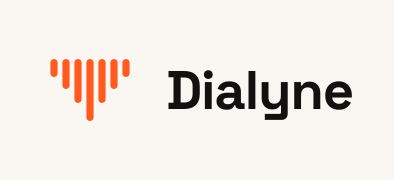

<p align="center">
  <picture>
    <source media="(prefers-color-scheme: dark)" srcset="assets/dialyne-logo-dark.svg">
    
  </picture>
</p>

# Dialyne — real phone calls in France for AI agents

**Website:** https://dialyne.com · **MCP server:** `https://mcp.dialyne.com/mcp` · **API:** `https://api.dialyne.com` · **Dashboard:** https://app.dialyne.com · **Docs:** https://dialyne.com/docs/ · **For agents:** https://dialyne.com/llms.txt

Dialyne gives an AI agent a phone line in France. The agent describes a task in plain language ("book a table for 4 on Friday around 8 pm for Martin"); Dialyne's voice agent calls the French number, introduces itself as the user's virtual assistant (an AI), navigates the phone menu, waits on hold, talks to the person, and returns a **written** result: outcome, summary and transcript.

This repository is the public showcase: MCP connection files for each client, an agent skill, examples and docs. The Dialyne service itself is hosted and closed-source; nothing here runs a server.

- 🇫🇷 French numbers (+33): landlines and mobiles. Calls are placed whenever the user asks, day or night; automatic retries (busy line, no answer) stay within 08:00–21:00 in the callee's time zone; a callback time the callee asks for is kept as they said it.
- 🤖 By default the agent says "Hello, this is Léa, <user>'s virtual assistant" and answers yes if asked whether it is an AI (EU AI Act art. 50). The user can customise how it introduces itself; it never denies being an AI. No marketing, prospecting or mass calling.
- ☎️ Phone menus (voice and keypad), hold time, questions to your agent during the call, hand-over to a human.
- 📝 Text only: no audio is recorded or returned. Transcripts are deleted automatically (after 90 days, or sooner if the user chooses).

## Connect

The server uses OAuth 2.1 (dynamic client registration, PKCE). Paste the URL; your client opens a Dialyne sign-in page the first time a tool is called. Agents without a browser can send an API key as `Authorization: Bearer <key>` instead. Never put a key in a URL.

| Client | How |
|---|---|
| Claude (claude.ai, Desktop) | Settings › Connectors › Add custom connector › `https://mcp.dialyne.com/mcp` |
| ChatGPT | Settings › Connectors (developer mode) › Create › URL above, authentication OAuth |
| Claude Code | `claude mcp add --transport http dialyne https://mcp.dialyne.com/mcp` — or install this repo as a plugin (`.claude-plugin/`) |
| Cursor | Install this repo as a plugin (`.cursor-plugin/`), or `~/.cursor/mcp.json`: `{"mcpServers": {"dialyne": {"url": "https://mcp.dialyne.com/mcp"}}}` |
| VS Code / Copilot | `.vscode/mcp.json`: `{"servers": {"dialyne": {"type": "http", "url": "https://mcp.dialyne.com/mcp"}}}` |
| Codex / ChatGPT plugins | `plugin.json` + `mcp.json` at the root (Agent Plugins format) and `.codex-plugin/plugin.json` |
| Gemini CLI | `gemini extensions install https://github.com/dialyne/dialyne-mcp` (`gemini-extension.json`) |
| OpenAI Responses API | `{"type": "mcp", "server_label": "dialyne", "server_url": "https://mcp.dialyne.com/mcp", "headers": {"Authorization": "Bearer <key>"}, "require_approval": "always"}` |
| Hermes, OpenClaw | Skill in [`skills/dialyne-phone-call/`](skills/dialyne-phone-call/SKILL.md) + API key in `DIALYNE_API_KEY` |
| n8n | [`examples/n8n/`](examples/n8n/) (HTTP Request nodes), or the MCP Client tool with the URL above |

Step-by-step instructions an agent can follow on its own: [`llms-install.md`](llms-install.md).

## Tools

| Tool | What it does |
|---|---|
| `place_phone_call` | Calls a French number with a task in plain language; returns a `call_id` immediately (the call runs 1–10 min in the background). Optional `language`, `scheduled_at`, `voice`, `idempotency_key`. |
| `get_call` | Status and written result; waits up to 50 s for news (answered, on hold, question, transfer, end). Repeat until `done=true`. |
| `answer_call_question` | Relays the user's answer when the voice agent asks something during the call (within ~45 s). |
| `hold_call_question` | Asks the callee for one more minute when the user needs time to answer a pending question (only if the callee agrees; never more than 2 minutes per question). |
| `transfer_call_to_user` | Hands the live call over to the user's phone. |
| `schedule_callback` | Calls the same number again later with the same task. |
| `cancel_call` | Cancels a scheduled call or hangs up a live one. |
| `list_calls` | Past and scheduled calls, searchable. |
| `get_account_balance` | Minutes of conversation left and account limits. |
| `configure_agent_identity` | Reads or changes how the voice agent introduces itself (name, tone, opening line, answer to "who is calling?", AI mention in the opening). Name and tone change freely; any other change needs the user's explicit, logged acceptance of the warning it returns. |
| `place_batch_calls` | Places the same call to a list of French numbers (Pro and Enterprise plans, 100 numbers at most); returns a `batch_id` and one `call_id` per number. Never for marketing or mass calling. |
| `get_batch_calls` | Progress and results of a batch: counts by status, successes, refused numbers, and each call's outcome and summary. |

Typical flow: `place_phone_call` → `get_call(wait_seconds=25)` until `done` → `answer_call_question` if a `pending_question` appears → report `outcome` and `summary`. Full reference: https://dialyne.com/docs/mcp

## Example

> **User:** Call Le Lys on 05 34 00 11 22 and book a table for 4 on Friday around 8 pm, name Martin. I prefer indoors.
>
> **Agent:** `place_phone_call(phone_number="+33534001122", task="Book a table for 4 on Friday around 8 pm for Martin. 7:30-9 pm is fine. Indoors preferred.")` → `get_call(...)` → the restaurant asks "terrace or indoors?" → `answer_call_question(call_id, "Indoors, please")` → `get_call(...)`
>
> **Agent:** Done: table for 4 on Friday at 7:45 pm, indoors, under Martin. 20:00 was full.

Code examples: [curl](examples/curl/), [Python](examples/python/), [TypeScript](examples/typescript/), [n8n](examples/n8n/).

## Rules built into the service
- Recommended identity by default: the agent introduces itself as the user's virtual assistant and says it is an AI whenever asked. The user can change this with `configure_agent_identity`; a change away from the recommended settings only applies after the user accepts a warning, which is logged, and the user is then responsible for those settings. One rule never changes: the agent never denies being an AI. Agents must show the warning to their user and never accept it on their behalf.
- Calls are placed whenever the user asks, day or night; automatic retries (busy line, no answer) stay within 08:00–21:00 in the callee's time zone; a callback time the callee asks for is kept as they said it.
- Only what French law forbids is refused: marketing, prospecting, surveys, mass calling (French Consumer Code art. L223-1 forbids phone canvassing of consumers without consent), threats, harassment and impersonation.
- Codes and card details: the user decides. Write a value as `[secret: value]` and Dialyne masks it in what it stores (card numbers are masked automatically); for a payment, prefer handing the call to the user.
- At most 5 calls per number per day across all customers; a person who asks not to be called again is blocked for every customer.
- Emergency, short and premium-rate numbers are refused.

Details: https://dialyne.com/legal/cgu

## Pricing
Same call quality on every plan; busy and unanswered calls are free; billed per second; hold time 0.04 € per minute.
- **Starter:** 0.20 € per minute of conversation, prepaid top-ups from 10 € (50 minutes). Credits are valid 30 days after each top-up. 5 test minutes after sign-up.
- **Pro:** 99 € per month + 0.17 € per minute, team and higher limits.
- **Enterprise:** on quote — contact@dialyne.com.

Your phone number is free while your account is active. Details: https://dialyne.com/tarifs/

## Repository layout
```
assets/                          Dialyne logo (light, dark) and app icon
server.json                      MCP Registry entry (com.dialyne/dialyne, remote only)
plugin.json, mcp.json            Agent Plugins manifest (Cursor, Codex/ChatGPT)
.claude-plugin/plugin.json       Claude Code plugin (+ .mcp.json)
.cursor-plugin/plugin.json       Cursor plugin
.codex-plugin/plugin.json        Codex / ChatGPT presentation overlay
gemini-extension.json            Gemini CLI extension
skills/dialyne-phone-call/      Agent skill (Claude Code, Codex, Cursor, Copilot, Gemini CLI, Hermes, OpenClaw)
llms-install.md                  Install steps for AI agents
examples/                        curl, Python, TypeScript, n8n
```

## Support and security
- Help: support@dialyne.com · Sales and Enterprise: contact@dialyne.com
- Security reports: see [SECURITY.md](SECURITY.md)
- Contributions to the examples and docs are welcome: see [CONTRIBUTING.md](CONTRIBUTING.md)

## License
MIT for everything in this repository (see [LICENSE](LICENSE)). The Dialyne service is subject to its own terms of service.
